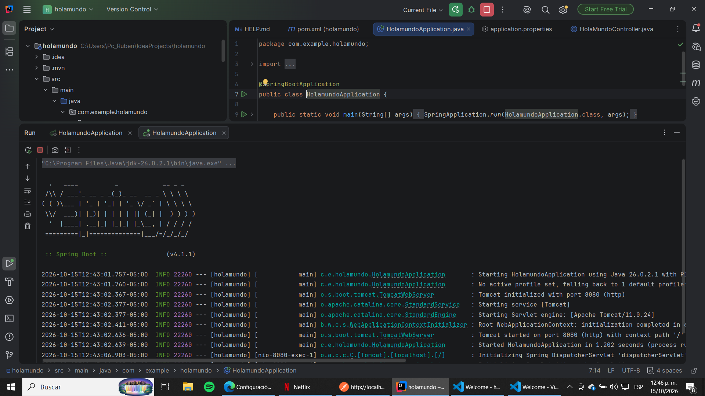

# Hola Mundo con Spring Boot

Aplicación web sencilla creada con Spring Boot. El proyecto expone un endpoint REST que responde con un saludo y puede probarse desde un navegador o una herramienta como Postman.

## Tecnologías

- Java 17
- Spring Boot 4.1.1
- Spring Web MVC
- Maven

## Estructura del proyecto

```text
src/
├── main/
│   ├── java/com/example/holamundo/
│   │   ├── HolamundoApplication.java
│   │   └── controller/
│   │       └── HolaMundoController.java
│   └── resources/
│       └── application.properties
└── test/
    └── java/com/example/holamundo/
        └── HolamundoApplicationTests.java
```

## Clases y trabajo realizado

- **`HolamundoApplication`**: clase principal de la aplicación. Usa `@SpringBootApplication` y arranca Spring Boot desde el método `main`.
- **`HolaMundoController`**: controlador REST. Define la ruta base `/api` y el endpoint `GET /hola`, que devuelve el texto `¡Hola Mundo desde Spring Boot!`.
- **`HolamundoApplicationTests`**: prueba de contexto que comprueba que la aplicación puede cargar.
- **`application.properties`**: establece el nombre de la aplicación como `holamundo`.

## Capturas

### Estructura de paquetes y clases


### Aplicación iniciada



### Prueba del endpoint en Postman


## Requisitos

- Tener instalado Java 17 o superior.
- No es necesario instalar Maven por separado: el proyecto incluye el Maven Wrapper.

## Ejecutar la aplicación

En Windows, desde la carpeta raíz del proyecto:

```powershell
.\mvnw.cmd spring-boot:run
```

Cuando la aplicación esté iniciada, abre esta dirección en el navegador o envía una petición `GET` desde Postman:

```text
http://localhost:8080/api/hola
```

Respuesta esperada:

```text
¡Hola Mundo desde Spring Boot!
```

## Ejecutar las pruebas

```powershell
.\mvnw.cmd test
```
